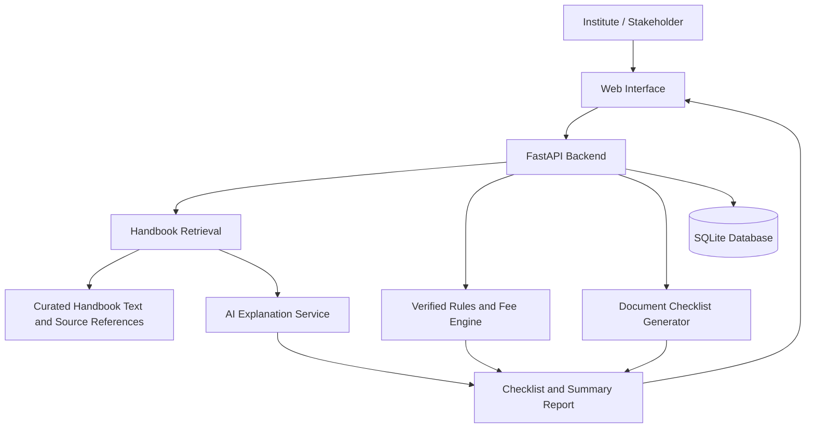

# AICTE Assistive Portal

An AI-assisted portal to help technical institutions understand applicable AICTE approval requirements, identify relevant documents, and review fee information based on their institution and course details.

> **Project status:** Initial documentation and repository scaffold. This is an academic prototype, not an official AICTE service. Requirements and fee values must be verified against the applicable official handbook and amendments before use.

## Problem Statement

AICTE's Approval Process Handbook can be difficult for institutions and stakeholders to navigate because requirements, documentation, and fee conditions may vary by application context. This project proposes a portal that converts selected handbook content into clearer, context-specific guidance.

## Proposed Solution

Users provide relevant institution and course details. The portal will use a curated set of handbook requirements to:
- Explain selected requirements in simpler language.
- Show the handbook section/page supporting each explanation.
- Generate a context-specific document checklist.
- Present a fee breakdown only where the applicable fee rules and values have been verified.
- Produce a summary report for review.

The system is intended to assist users. It will not make official approval decisions or replace the current AICTE process.

## Key Features (Planned)

1. Institution/course information form.
2. Handbook content extraction and retrieval.
3. AI-assisted answers grounded in retrieved handbook passages.
4. Requirement and document checklist.
5. Rule-based fee calculation using verified values and conditions.
6. Downloadable summary report.
7. Clear indication of handbook edition, source references, and unverified items.

## Target Users

- Technical institutions preparing approval-related information.
- Administrative staff and other stakeholders who need to understand requirements.
- Project evaluators reviewing the prototype.

## Proposed Tech Stack

- **Frontend:** React + CSS (or a simpler interface if needed)
- **Backend:** Python + FastAPI
- **Document processing:** PyMuPDF
- **AI/retrieval:** LLM API with retrieval-augmented generation (RAG)
- **Database:** SQLite initially
- **Reports:** ReportLab
- **Version control:** Git + GitHub

The stack may be adjusted by the team after a short feasibility review.

## High-Level Architecture



See [docs/architecture.md](docs/architecture.md) and [docs/er-diagram.md](docs/er-diagram.md).

## Repository Structure

```text
aicte-assistive-portal/
├── frontend/
├── backend/
├── data-processing/
├── database/
│   ├── schema.sql
│   ├── seed.sql
│   └── queries.sql
├── docs/
│   ├── problem-statement.md
│   ├── architecture.md
│   └── er-diagram.md
├── .gitignore
└── README.md
```

## Team Members and Responsibilities

Replace the placeholders with the team's names and agreed responsibilities.

| Member | Responsibility |
|---|---|
| Member 1: Add name | Handbook processing, retrieval, and AI answers |
| Member 2: Add name | Requirements, verified fee rules, and report generation |
| Member 3: Add name | Frontend, API integration, and testing |

All members should review the overall workflow, test the integrated application, and understand their contributions.

## Setup Instructions

At this initial stage, the folders are scaffolding and the application is not yet implemented.

### Clone the repository

```bash
git clone https://github.com/YOUR-USERNAME/aicte-assistive-portal.git
cd aicte-assistive-portal
```

Replace `YOUR-USERNAME` with the GitHub account that owns the repository.

### Planned backend setup

```bash
cd backend
python -m venv .venv
```

Activate the environment:

- Windows: `.venv\Scripts\activate`
- macOS/Linux: `source .venv/bin/activate`

Install dependencies once `requirements.txt` has been added.

### Planned frontend setup

After the React application is created, follow the instructions in `frontend/README.md`.

## Responsible Use and Accuracy

- Record the applicable handbook edition and amendments used.
- Keep a source reference for each extracted requirement.
- Do not let an AI model invent fees, eligibility rules, or mandatory documents.
- Calculate fees using explicit, testable rules and verified values.
- Show uncertainty and direct users to official sources where information is incomplete.
- Do not upload confidential institutional or personal data to third-party AI services without permission.

## Current Progress

- [x] Initial problem statement and proposed solution documented
- [x] Initial architecture and ER diagram drafted
- [x] Database scaffold created
- [ ] Confirm handbook edition and target approval scenario
- [ ] Curate and verify the initial set of requirements
- [ ] Implement backend and retrieval pipeline
- [ ] Implement frontend
- [ ] Integrate checklist and fee engine
- [ ] Test and prepare demo

## Contributing

1. Discuss the task with the team before making major changes.
2. Create a branch for each feature or fix.
3. Make focused commits with meaningful messages.
4. Open a pull request for review where practical.
5. Never commit API keys, passwords, private documents, or confidential data.

Example branch and commit:

```bash
git checkout -b docs/update-readme
git add README.md
git commit -m "docs: add project overview"
git push -u origin docs/update-readme
```

## Disclaimer

This repository is an academic prototype and is not affiliated with or endorsed by AICTE. Always verify regulatory requirements and fees against the applicable official AICTE publications and notices.
