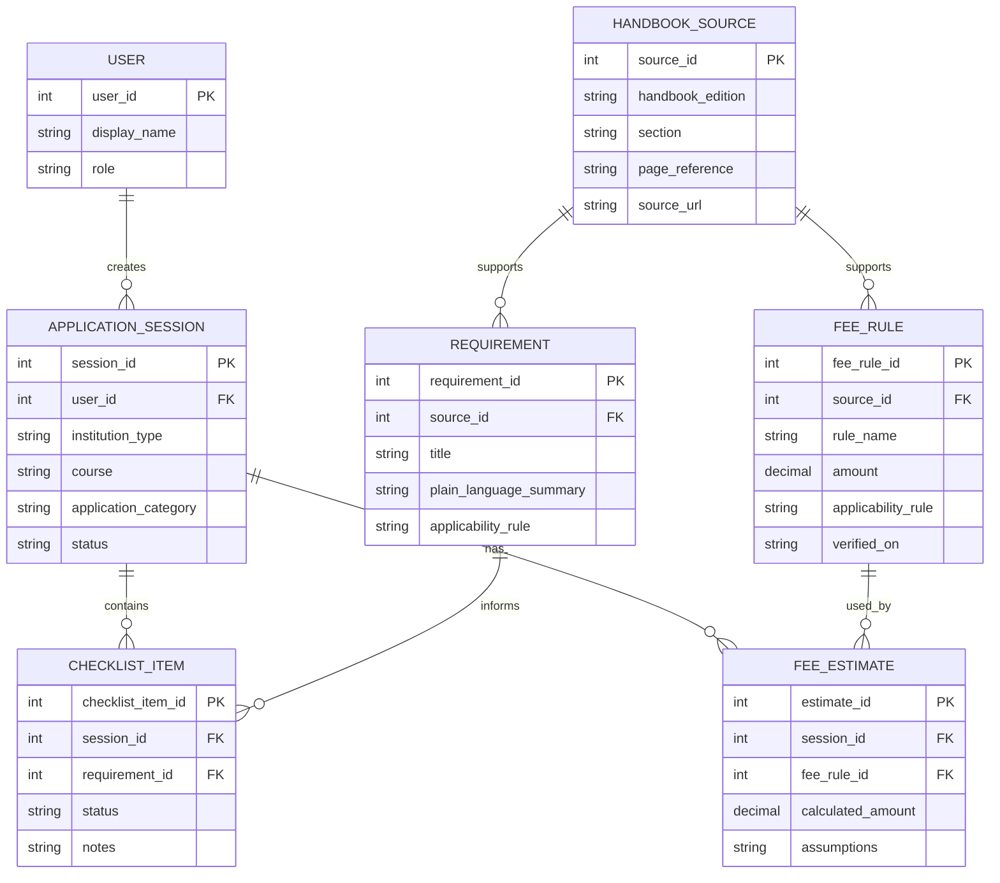

# Initial ER Diagram

This is a proposed starting model. Adjust it after the team confirms the exact scenario and data requirements.

## Notes

- `amount` should only be populated from a verified applicable source.
- Consider storing fee values in integer paise or using a suitable decimal type in the application to avoid floating-point rounding errors.
- This model is illustrative, not a claim about AICTE's official data model.
